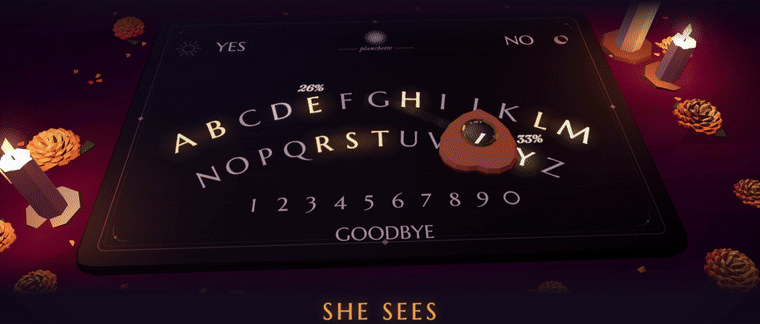
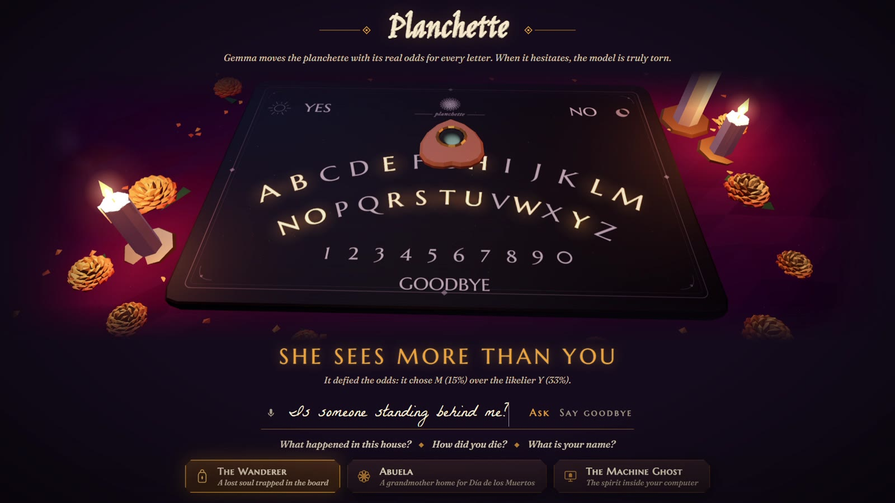

# Planchette

**A Ouija board haunted by an open AI model.**



You ask the spirit a question and Gemma (running locally on your machine) answers it, one letter at a time on the board. The planchette isn't animated by hand. It moves according to **Gemma's real probability for the next letter**, so if Gemma is sure it goes straight there, and if it's torn between two letters you can watch it swing between them before it picks one.

▶ **[Watch the demo](https://vimeo.com/1241776139/5405ea774b)**



## Features

- **Three spirits**
  - **The Wanderer**, a lost soul trapped in the board
  - **Abuela**, a grandmother home for Día de los Muertos
  - **The Machine Ghost**, which lives inside your computer
- **Live odds.** While it's deciding, the board shows the top few letters it's considering and what it's torn between.
- **It doesn't always let you leave.** When you say goodbye, Gemma is asked if it wants you to stay, and if it does, the planchette drags itself back to NO and tells you why.
- **It moves on its own.** Leave it alone for a bit after an answer and it starts spelling something by itself.
- **Sound.** Room tone, a faraway music box, knocks, creaks and a gust when the candles go out. The whispers get louder the more unsure the model is.
- **Offline.** No accounts, no API needed, nothing you type leaves your computer.

## Run it

You need [Ollama](https://ollama.com) and Python 3.10 or newer. Nothing else: no `pip install`, no build step.

```bash
ollama pull gemma3
python server.py
```

On Windows you can just double-click **`start.bat`**. The board opens at <http://localhost:7666>.

The first question can take around 30 seconds while Gemma loads into memory. After that, answers take a few seconds.

**Keyboard:** `Esc` lets go of the planchette, `M` mutes, `F` toggles full screen.

### Optional: ElevenLabs

The sound effects in `sounds/` were generated once with the ElevenLabs Sound Effects API and are included. To regenerate them, or to ask your questions out loud with the mic button (speech-to-text), copy `.env.example` to `.env` and add your key:

```
ELEVENLABS_API_KEY=your-key-here
```

The key needs the **Sound Effects** and **Speech to Text** permissions. Without a key everything still works: the included sounds play, and any missing ones fall back to built-in Web Audio sounds.

## How it works

For every step, the server asks Ollama for exactly **one** token with `logprobs` and the top 20 alternatives:

```python
{"model": "gemma3:4b", "prompt": prompt, "raw": True,
 "logprobs": True, "top_logprobs": 20, "options": {"num_predict": 1}}
```

Models think in tokens (`DARK`, `NESS`, ` WATCH`), not letters. So Planchette lets Gemma pick a whole token, sampled from its own distribution, and then **spells** it. At each letter, it groups the candidate tokens by the letter that comes next and adds up their probabilities. That gives the real odds for the next letter on the board, and the planchette is pulled between candidates by exactly that much.

Because of this, the planchette usually glides through the middle of a word (the model has already committed) and hesitates at the start of words, which is where it's actually deciding.

Everything lives in a few files:

| File | What it does |
|---|---|
| `engine.py` | the séance: token sampling, letter odds, the three spirits |
| `server.py` | a small standard-library HTTP server that streams each step to the browser |
| `web/board3d.js` | the low-poly 3D board (three.js), with candles, marigolds and planchette physics |
| `web/audio.js` | the room's sound: samples plus procedural Web Audio |
| `web/app.js` | the page: questions, goodbyes, the planchette moving on its own |

Other Ollama models work too, as long as they return logprobs. I use Gemma 3 4B because it's small enough to run fast on a laptop, and its answers are properly creepy.

## Credits

- [Gemma 3](https://ai.google.dev/gemma) by Google DeepMind, run with [Ollama](https://ollama.com)
- Sound effects generated with [ElevenLabs](https://elevenlabs.io)
- [three.js](https://threejs.org) (MIT), included in `web/vendor`
- Fonts: Jim Nightshade, Marcellus SC, Fraunces, IM Fell DW Pica, La Belle Aurore (all SIL Open Font License, see `web/fonts`)

Built for the DEV [Hacktoberfest Open-Source AI Challenge: Ghost in the Machine](https://dev.to/challenges/hacktoberfest-week4-2026-10-26).

## License

MIT
